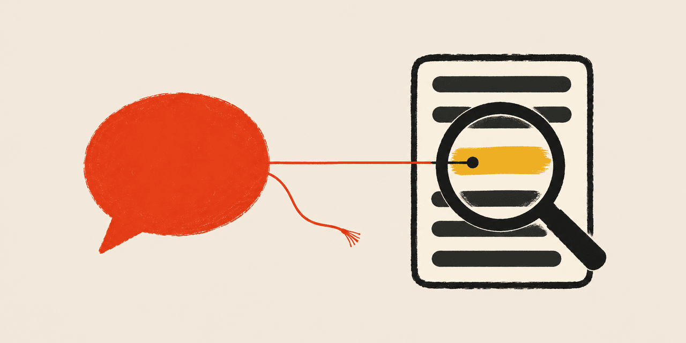

# chat-citation-check



A small Python library that removes citations an LLM cannot back up. It checks each page-and-line citation in an answer against the lines your tools really returned to the model, and it tells the user what it removed.

Portfolio: https://suphanut.pages.dev

## Why it exists

A chat-with-documents assistant often answers with citations such as `[lease-0042 p.2 L5]`. Users trust a citation more than the sentence around it. A model can still cite:

- a document it only saw in a search result list
- a page it never opened
- a line next to the one it read
- a quote that is not on the cited line

Each of these looks sourced and is not. The fix is not a better prompt. Keep a record of what the tools returned, and check every citation against that record before the answer reaches the user.

## How it works

1. Each time a tool returns page text to the model, record those lines in a `ReadLedger`.
2. After the model answers, call `check_answer(answer, ledger)`.
3. For each citation, the checker confirms the document, the page, and every cited line are in the ledger. If the sentence quotes text in double quotes, the quote must appear on the cited lines. Case, Unicode width, and extra spaces are ignored.
4. The checker removes each failed citation. A sentence that loses all of its citations gets an `[unverified]` marker, so it no longer looks sourced.
5. `result.notice()` returns a short message for the user that lists each removed citation and the reason.

The citation format is `[<doc-id> p.<page> L<line>]` or `[<doc-id> p.<page> L<first>-<last>]`. A range may cover at most 40 lines.

## Run it

You need Python 3.9 or later. The library has no dependencies.

1. Run the demo from the repository root:

	```sh
	PYTHONPATH=src python3 examples/demo.py
	```

2. Run the tests:

	```sh
	python3 -m pip install pytest
	python3 -m pytest
	```

	If you use `uv`, run `uv run --no-project --with pytest python -m pytest` instead.

## Example

The demo uses made-up documents in `examples/documents.py`. The scripted assistant reads all of page 2 of a lease and lines 1-2 of page 3. It then answers with six citations. Three of them are wrong on purpose.

```python
from citation_check import ReadLedger, check_answer

ledger = ReadLedger()
ledger.record("lease-0042", 2, {2: "The monthly rent is 15,000 baht, due on the 5th day of each month."})

result = check_answer(
	'Rent is "15,000 baht" [lease-0042 p.2 L2]. The deposit is kept [lease-0042 p.3 L3].',
	ledger,
)
print(result.text)
# Rent is "15,000 baht" [lease-0042 p.2 L2]. The deposit is kept [unverified].
print(result.notice())
# 1 citation removed because the source did not support it:
# - lease-0042 page 3, line 3: the assistant never read this page
# Sentences marked [unverified] have no remaining source. Check them before you rely on them.
```

To turn each kept citation into a link to the page viewer, pass `link_template="/docs/{doc}/pages/{page}#L{start}-L{end}"`.

## Limits

- The checker proves that a citation points at text the model saw. It does not prove that the text supports the claim. Pair it with an eval set that has known answers.
- Quote checks cover only text in double quotes. A paraphrase is not checked.
- Sentences are split on `.`, `!`, `?` followed by a space, and on line breaks. An abbreviation such as `No. 5` starts a new sentence.
- Only the citation format above is recognised. Change `CITATION` in `src/citation_check/check.py` if your model uses a different format.
- Recording the ledger is your job. If your tool layer records pages the model never received, the check passes when it should not.

## Licence

[MIT](LICENSE)
